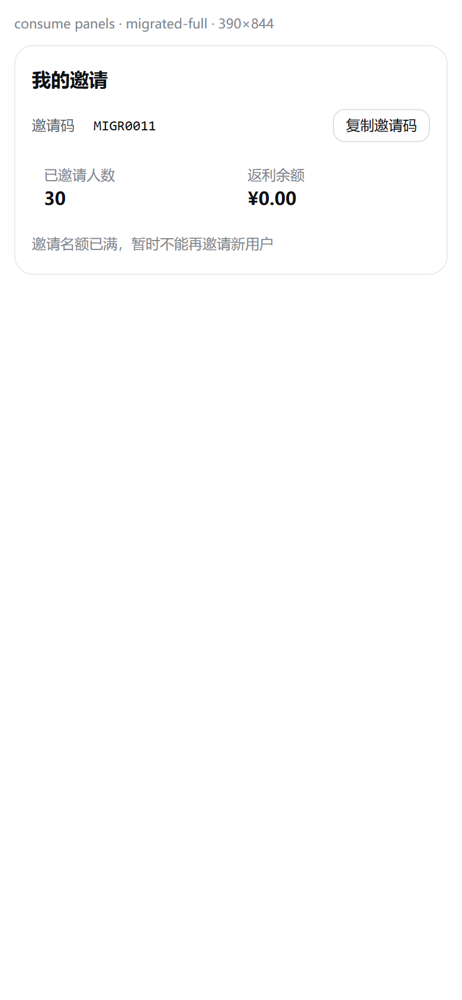
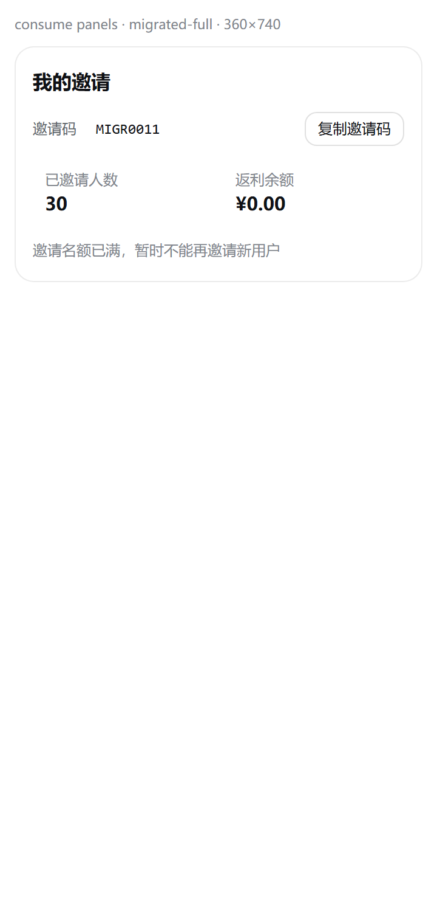
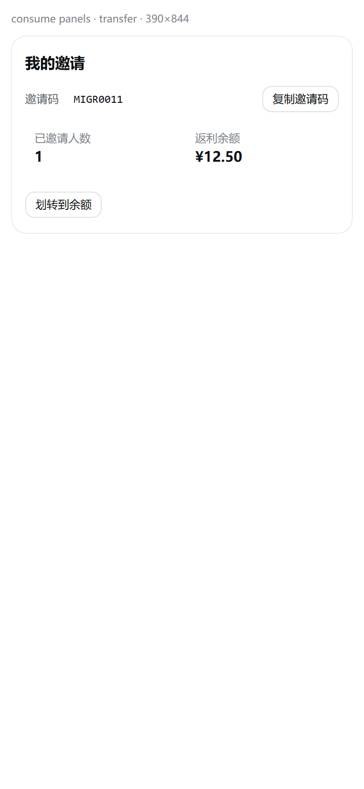
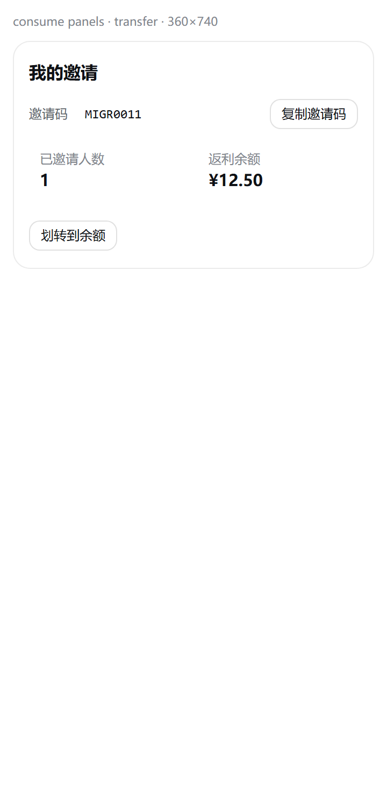
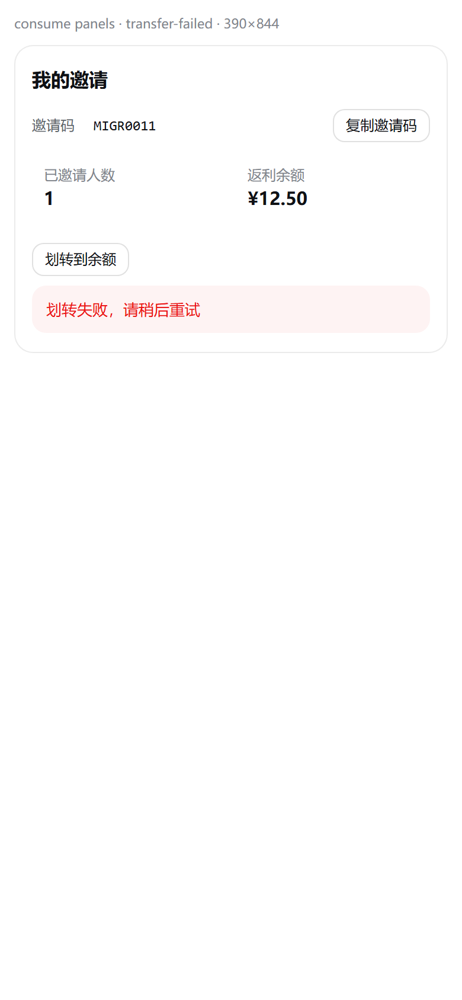
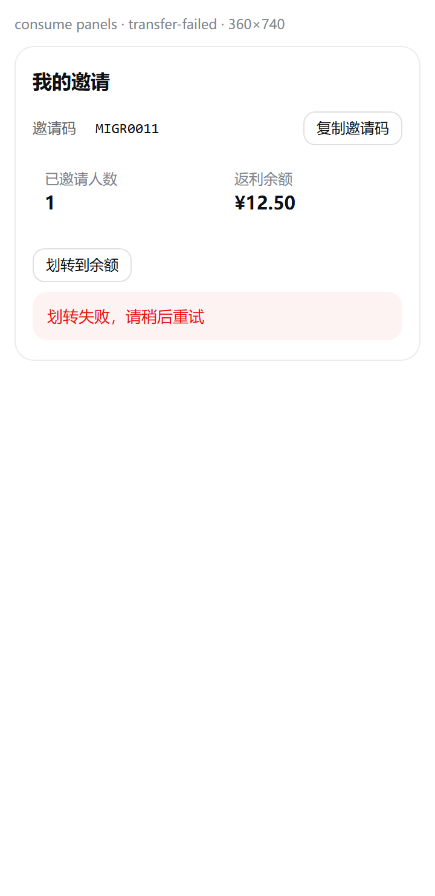

# #860 邀请面板截图（组件级渲染，**不是真机截图**）

`node scripts/shot-invite-860.mjs --out=docs/ui/860-invite-panel` 生成。用真视图函数 `InvitePanelView` + 真样式表，
Playwright 按 390×844 / 360×740 渲染；数据全是脚本里的 mock 夹具，未对真实接口验证（划转没有任何真实响应样本）。

| 场景 | 390 | 360 |
| --- | --- | --- |
| 迁移用户：`aff_count=30`、`invitees=[]`、`invite_remaining=0` → 人数 30 + 「名额已满」 |  |  |
| 有可划转返利：出现「划转到余额」 |  |  |
| 划转失败：只显示失败文案，不显示成功 |  |  |

三张图在两个宽度下横向溢出均为 0px（脚本逐张检查）。
